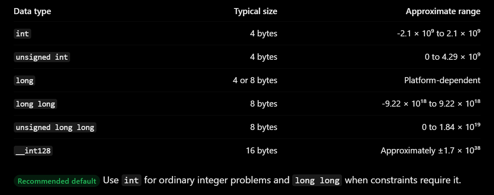
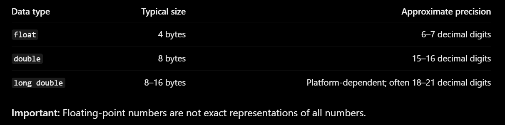

# Data Types

## Integer Types

---

## Floating-point Types

---

### Constraints / Maximum Value

| Constraint | Recommended type |
|---|---|
| Up to \(10^9\) | `int` |
| Up to \(10^{12}\) | `long long` |
| Up to \(10^{18}\) | `long long` |
| Above \(10^{18}\) | `__int128` or another approach |